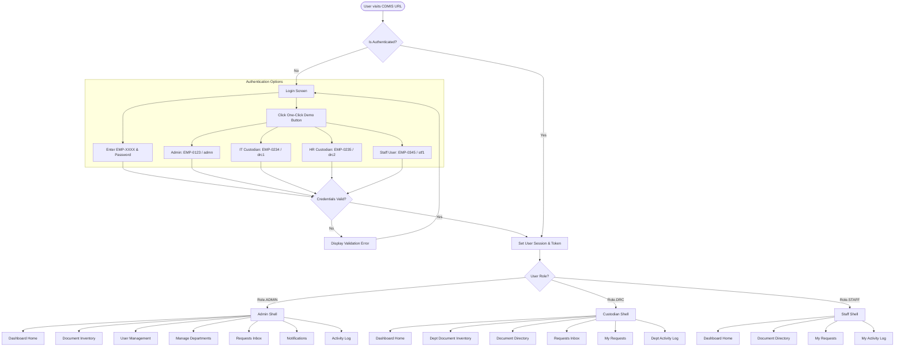
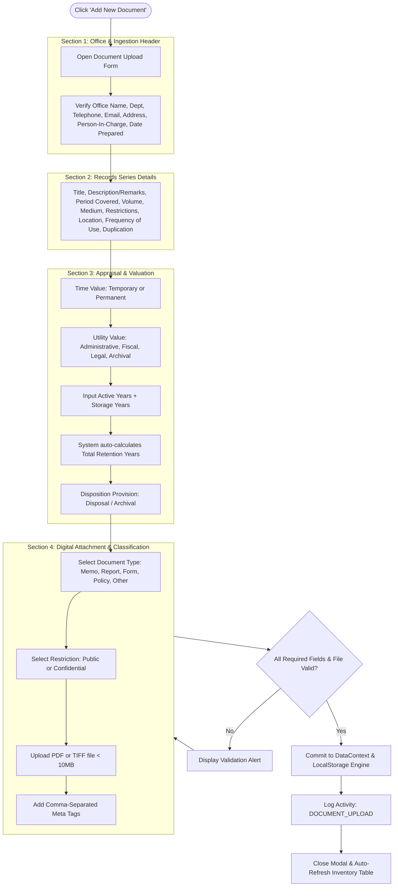
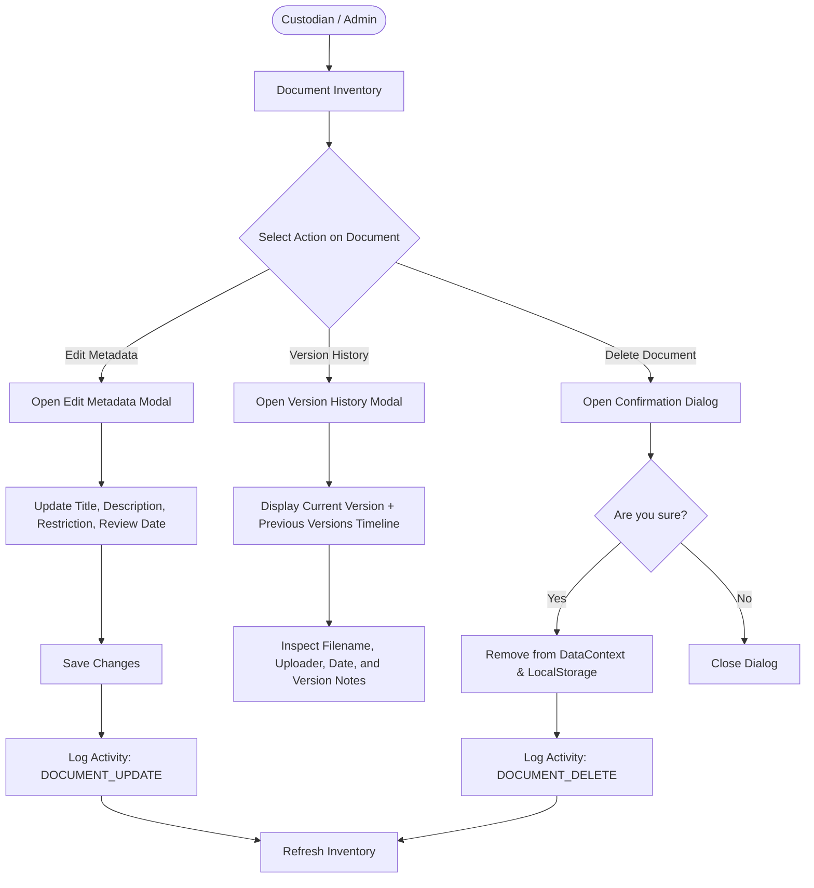
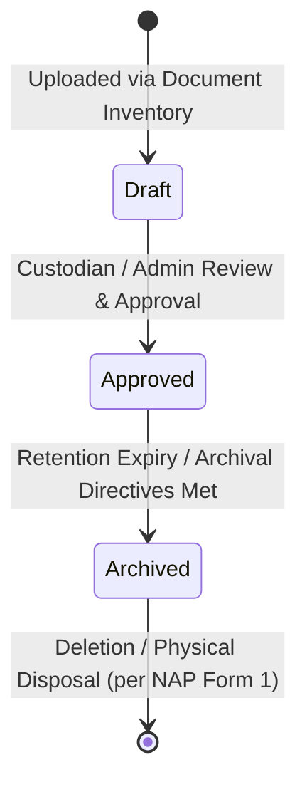
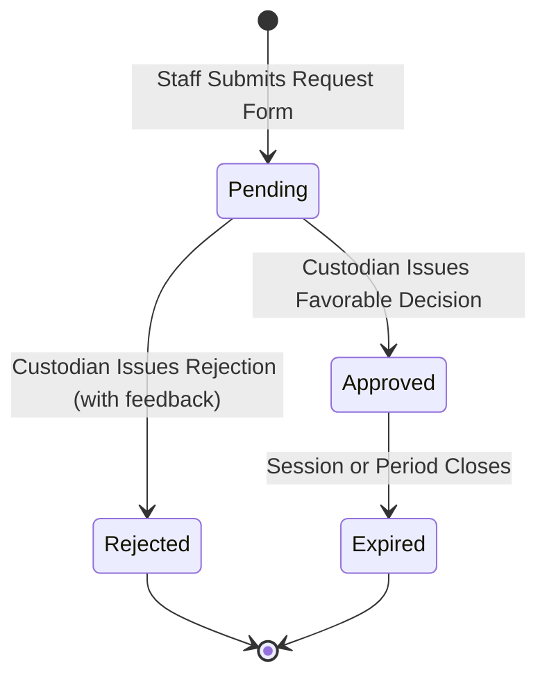

# Application Flow & User Journeys (APP_FLOW)
## Centralized Document Management Information System (CDMIS)

---

## 1. Global Navigation & View Routing Flowchart

The following diagram illustrates how users navigate the application from entry to their respective role-based viewports:



---

## 2. Core Operational Workflows

### 2.1 Confidential Document Request & Approval Sequence

This flow illustrates the interaction between a Staff member requesting a confidential document and the Records Custodian approving it:

```mermaid
sequenceDiagram
    autonumber
    actor Staff as Staff User (Requester)
    participant Dir as Document Directory
    participant Modal as Request Document Modal
    participant Engine as DataContext & MockAPI
    actor Custodian as Records Custodian (DRC)
    participant Inbox as Requests Inbox
    participant Viewer as Document Viewer

    Staff->>Dir: Browses records list & encounters Confidential Document
    Dir->>Staff: Displays "Request" button (Preview disabled)
    Staff->>Dir: Clicks "Request"
    Dir->>Modal: Opens Request Modal
    Staff->>Modal: Fills Purpose & Attaches ID verification
    Modal->>Engine: createRequest(docId, requesterId, purpose, idFile)
    Engine->>Engine: Generate request ID (Status: PENDING)
    Engine->>Engine: Post Activity Log ("REQUEST_SUBMIT")
    Engine->>Custodian: Dispatch Real-Time Notification
    Modal-->>Staff: Closes modal; Table shows "Pending" badge

    Custodian->>Inbox: Navigates to Requests Inbox
    Inbox->>Custodian: Displays Pending Request with Requester details & purpose
    Custodian->>Inbox: Reviews justification and clicks "Approve" (with comments)
    Inbox->>Engine: processRequest(requestId, APPROVED, comments)
    Engine->>Engine: Update Request status to APPROVED
    Engine->>Engine: Post Activity Log ("REQUEST_APPROVE")
    Engine->>Staff: Dispatch "Access Approved" Notification

    Staff->>Dir: Returns to Document Directory
    Dir->>Engine: Checks access permissions
    Engine-->>Dir: Access granted (Status: APPROVED)
    Dir-->>Staff: "Request" button replaced by "View Document" eye icon
    Staff->>Viewer: Clicks View; High-resolution PDF/Image loads in viewer
```

---

### 2.2 NAP Form 1 Records Ingestion Workflow

Records Custodians and Administrators use the standardized 4-section modal to ingest documents into the institutional repository:



---

### 2.3 Document Version History & Metadata Management



---

### 2.4 User & Department Provisioning Flow (Administrator Only)

```mermaid
flowchart LR
    Admin([Administrator]) --> UserMgmt[User Management View]
    
    subgraph UserLifecycle [User Account Management]
        UserMgmt --> AddUser[Click 'Add User']
        AddUser --> UserForm[Input Employee ID 'EMP-XXXX', Name, Role, Dept, Password]
        UserForm --> ValidateRegex{Regex Check: ^EMP - \\d{4}$ ?}
        ValidateRegex -- Invalid --> ShowRegexError[Display Format Error]
        ValidateRegex -- Valid --> HashPass[Generate Mock MD5 Hash]
        HashPass --> CommitUser[Add User to Directory & LocalStorage]
        CommitUser --> LogUser[Log Activity: USER_CREATE]
    end

    Admin --> DeptMgmt[Manage Departments View]
    subgraph DeptLifecycle [Department Catalog Management]
        DeptMgmt --> AddDept[Input Department Name]
        AddDept --> CommitDept[Save to Catalog & LocalStorage]
        CommitDept --> LogDept[Log Activity: DEPARTMENT_CREATE]
    end
```

---

## 3. State Transition Model

### 3.1 Document Lifecycle States



### 3.2 Access Request Lifecycle States


