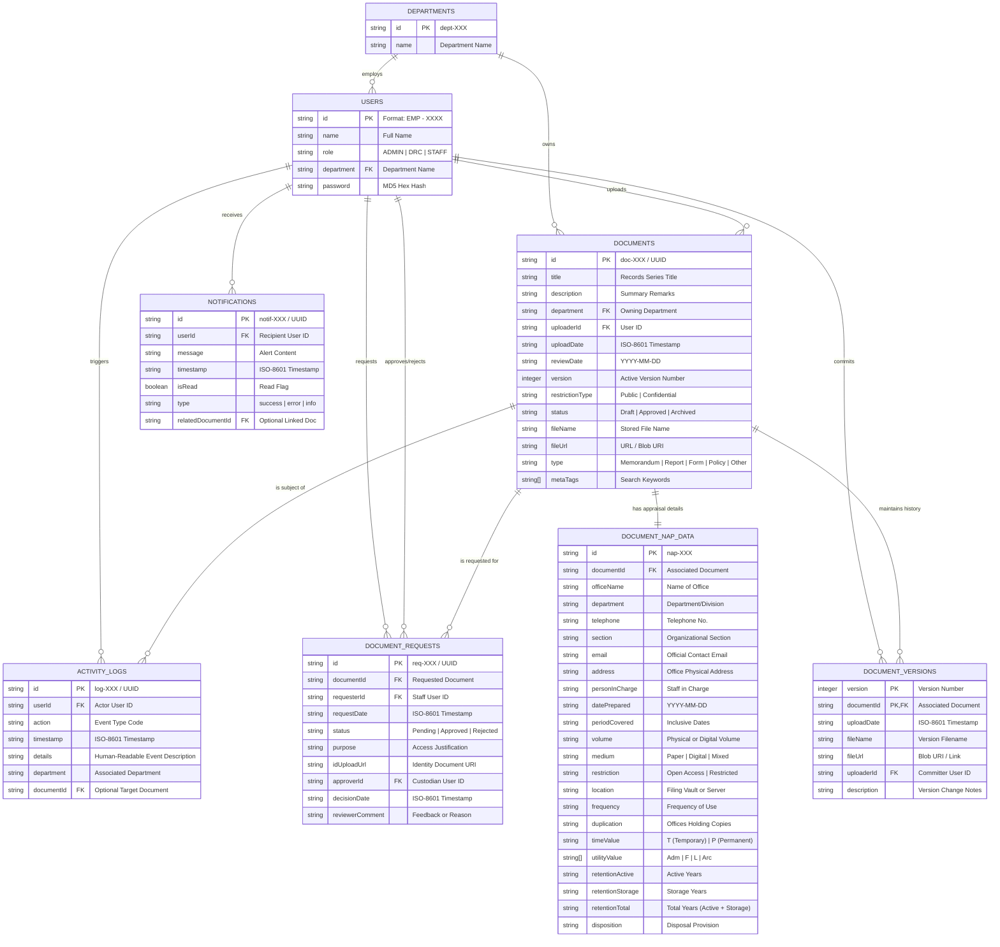

# Background Schema & Data Models (BACKGROUND_SCHEMA)
## Centralized Document Management Information System (CDMIS)

---

## 1. Entity-Relationship Diagram (ERD)

The following diagram defines the entity relationships, foreign key constraints, and cardinalities underpinning CDMIS:



---

## 2. Table Data Dictionaries & Type Definitions

### 2.1 Table: `users`
Represents faculty, staff, department custodians, and system administrators.
- **Primary Key:** `id` (e.g., `'EMP - 0123'`)
- **Format Validation:** Regular expression `^EMP - \d{4}$`

| Column | Data Type | Nullable | Default | Description / Rules |
| :--- | :--- | :---: | :---: | :--- |
| `id` | `VARCHAR(32)` | No | - | Formatted employee identifier (`EMP - XXXX`). |
| `name` | `VARCHAR(128)` | No | - | Full name of the user. |
| `role` | `VARCHAR(32)` | No | `'Staff'` | Role enum: `'Administrator'`, `'Departmental Records Custodian'`, `'Staff'`. |
| `department` | `VARCHAR(128)` | Yes | `NULL` | Department assignment; links to `departments.name`. |
| `password` | `VARCHAR(64)` | No | - | MD5 digest (or simulated hash) of the user credential. |

---

### 2.2 Table: `departments`
Catalog of administrative divisions, academic units, and college departments.
- **Primary Key:** `id` (e.g., `'dept-1'`)

| Column | Data Type | Nullable | Default | Description |
| :--- | :--- | :---: | :---: | :--- |
| `id` | `VARCHAR(32)` | No | - | Unique department code. |
| `name` | `VARCHAR(128)` | No | - | Official department title (e.g., `'IT'`, `'HR'`, `'Finance'`). |

---

### 2.3 Table: `documents`
The core document entity storing general records metadata, lifecycle status, and classification.
- **Primary Key:** `id` (e.g., `'doc-1'`)

| Column | Data Type | Nullable | Default | Description |
| :--- | :--- | :---: | :---: | :--- |
| `id` | `VARCHAR(64)` | No | - | Unique document identifier. |
| `title` | `VARCHAR(255)` | No | - | Records series title and subject matter. |
| `description`| `TEXT` | Yes | `NULL` | Detailed summary, notes, or remarks. |
| `department` | `VARCHAR(128)` | No | - | Owning organizational unit. |
| `uploaderId` | `VARCHAR(32)` | No | - | ID of user who uploaded the document. |
| `uploadDate` | `DATETIME` | No | `CURRENT_TIMESTAMP` | Initial upload timestamp. |
| `reviewDate` | `DATE` | Yes | `NULL` | Scheduled renewal or appraisal review date. |
| `version` | `INT` | No | `1` | Current active document revision number. |
| `restrictionType`| `VARCHAR(20)`| No | `'Public'` | Access level: `'Public'` or `'Confidential'`. |
| `status` | `VARCHAR(20)` | No | `'Draft'` | Document lifecycle status: `'Draft'`, `'Approved'`, `'Archived'`. |
| `fileName` | `VARCHAR(255)` | No | - | Original uploaded file name. |
| `fileUrl` | `TEXT` | Yes | `NULL` | Direct access URL or Blob URI. |
| `type` | `VARCHAR(50)` | No | `'Report'` | Classification: `'Memorandum'`, `'Report'`, `'Form'`, `'Policy'`, `'Other'`. |
| `metaTags` | `TEXT` / `JSON`| No | `'[]'` | Array of search index keywords. |

---

### 2.4 Table: `document_nap_data`
Specific archival appraisal metadata required for **National Archives Form 1 (Records Inventory and Appraisal)** compliance.
- **Primary Key:** `documentId` (1-to-1 relationship with `documents`)

| Column | Data Type | Nullable | Description / Standard Source |
| :--- | :--- | :---: | :--- |
| `documentId` | `VARCHAR(64)` | No | Reference to `documents.id`. |
| `officeName` | `VARCHAR(128)` | No | Header: Name of the university / institutional agency. |
| `department` | `VARCHAR(128)` | No | Department / Division handling the record. |
| `telephone` | `VARCHAR(64)` | Yes | Contact telephone number. |
| `section` | `VARCHAR(64)` | Yes | Specific office unit / section. |
| `email` | `VARCHAR(128)` | Yes | Official department email address. |
| `address` | `VARCHAR(255)` | Yes | Physical headquarters or campus location. |
| `personInCharge` | `VARCHAR(128)` | No | Records Custodian responsible for files. |
| `datePrepared` | `DATE` | No | Appraisal preparation date. |
| `periodCovered` | `VARCHAR(64)` | Yes | Inclusive dates (e.g., `'2023-2024'`). |
| `volume` | `VARCHAR(64)` | Yes | Physical/digital extent (e.g., `'1 Folder'`, `'500MB'`). |
| `medium` | `VARCHAR(64)` | Yes | Storage medium: `'Paper'`, `'Digital'`, `'Mixed'`. |
| `location` | `VARCHAR(128)` | Yes | Physical filing cabinet or digital directory. |
| `frequency` | `VARCHAR(64)` | Yes | Frequency of access: `'Daily'`, `'Once a month'`, `'ANA'`. |
| `duplication` | `VARCHAR(128)` | Yes | Units or offices holding duplicates. |
| `timeValue` | `CHAR(1)` | Yes | `'T'` (Temporary) or `'P'` (Permanent). |
| `utilityValue` | `TEXT` / `JSON`| Yes | Array of values: `['Adm', 'F', 'L', 'Arc']`. |
| `retentionActive` | `VARCHAR(16)` | Yes | Active retention period in years. |
| `retentionStorage`| `VARCHAR(16)` | Yes | Inactive storage retention period in years. |
| `retentionTotal` | `VARCHAR(16)` | Yes | Total retention period (`Active + Storage`). |
| `disposition` | `VARCHAR(128)` | Yes | Final disposition: `'Disposal'`, `'Archival Transfer'`. |

---

### 2.5 Table: `document_versions`
Audit history of revisions committed to a document series.
- **Primary Key:** `(documentId, version)`

| Column | Data Type | Nullable | Description |
| :--- | :--- | :---: | :--- |
| `documentId` | `VARCHAR(64)` | No | Reference to parent `documents.id`. |
| `version` | `INT` | No | Version number (1, 2, 3...). |
| `uploadDate` | `DATETIME` | No | Timestamp version was uploaded. |
| `fileName` | `VARCHAR(255)` | No | Name of uploaded file for this revision. |
| `fileUrl` | `TEXT` | Yes | Resource URI. |
| `uploaderId` | `VARCHAR(32)` | No | User who authored this version. |
| `description` | `TEXT` | Yes | Commit notes or changes summary. |

---

### 2.6 Table: `document_requests`
Workflows governing access permissions for confidential documents.
- **Primary Key:** `id` (e.g., `'req-1'`)

| Column | Data Type | Nullable | Description |
| :--- | :--- | :---: | :--- |
| `id` | `VARCHAR(64)` | No | Unique request identifier. |
| `documentId` | `VARCHAR(64)` | No | Target confidential document. |
| `requesterId` | `VARCHAR(32)` | No | User requesting access. |
| `requestDate` | `DATETIME` | No | Timestamp request was filed. |
| `status` | `VARCHAR(20)` | No | Current status: `'Pending'`, `'Approved'`, `'Rejected'`. |
| `purpose` | `TEXT` | No | Business justification provided by requester. |
| `idUploadUrl` | `TEXT` | Yes | Verification identity document attachment. |
| `approverId` | `VARCHAR(32)` | Yes | Custodian or Admin who reviewed request. |
| `decisionDate`| `DATETIME` | Yes | Timestamp decision was finalized. |
| `reviewerComment` | `TEXT` | Yes | Decision remarks, conditions, or rejection reason. |

---

### 2.7 Table: `activity_logs`
Chronological, append-only system audit events.
- **Primary Key:** `id` (e.g., `'log-1'`)

| Column | Data Type | Nullable | Description |
| :--- | :--- | :---: | :--- |
| `id` | `VARCHAR(64)` | No | Unique log record ID. |
| `userId` | `VARCHAR(32)` | No | User initiating the action. |
| `action` | `VARCHAR(64)` | No | Standard event code (`DOCUMENT_UPLOAD`, `DOCUMENT_DELETE`, etc.). |
| `timestamp` | `DATETIME` | No | Accurate ISO-8601 event timestamp. |
| `details` | `TEXT` | No | Descriptive log message. |
| `department` | `VARCHAR(128)` | Yes | Associated department for scoped audits. |
| `documentId` | `VARCHAR(64)` | Yes | Associated document ID if applicable. |

---

### 2.8 Table: `notifications`
Real-time user alerts and workflow updates.
- **Primary Key:** `id` (e.g., `'notif-1'`)

| Column | Data Type | Nullable | Description |
| :--- | :--- | :---: | :--- |
| `id` | `VARCHAR(64)` | No | Unique notification ID. |
| `userId` | `VARCHAR(32)` | No | Recipient user ID. |
| `message` | `TEXT` | No | Notification text. |
| `timestamp` | `DATETIME` | No | Alert dispatch timestamp. |
| `isRead` | `BOOLEAN` | No | `false` until acknowledged by recipient. |
| `type` | `VARCHAR(16)` | No | Badge category: `'success'`, `'error'`, `'info'`. |
| `relatedDocumentId`| `VARCHAR(64)`| Yes | Deep-link target document ID. |

---

## 3. Client Storage Serialization Architecture

In the zero-backend client-persistent setup, the relational schema above maps directly to discrete `localStorage` keys:

```
+---------------------------------------------------------------------------------+
|                                BROWSER LOCALSTORAGE                             |
+------------------------+--------------------------------------------------------+
| Storage Key            | Serialized Type & Payload                              |
+------------------------+--------------------------------------------------------+
| "cdmis_users"          | User[] -> [{ id, name, role, department, password }]   |
| "cdmis_departments"    | Department[] -> [{ id, name }]                         |
| "cdmis_documents"      | Document[] (including nested NAPData & Version[])      |
| "cdmis_requests"       | DocumentRequest[] -> [{ id, docId, status, purpose }]  |
| "cdmis_logs"           | ActivityLog[] -> [{ id, userId, action, timestamp }]   |
| "cdmis_notifications"  | Notification[] -> [{ id, userId, message, isRead }]    |
+------------------------+--------------------------------------------------------+
```

### Production Migration Pathway (SQL DDL Equivalent)
For deployment with PostgreSQL / Cloud SQL, the schema translates to:
```sql
CREATE TABLE departments (
    id VARCHAR(32) PRIMARY KEY,
    name VARCHAR(128) NOT NULL UNIQUE
);

CREATE TABLE users (
    id VARCHAR(32) PRIMARY KEY,
    name VARCHAR(128) NOT NULL,
    role VARCHAR(32) NOT NULL,
    department VARCHAR(128) REFERENCES departments(name) ON DELETE SET NULL,
    password_hash VARCHAR(64) NOT NULL
);

CREATE TABLE documents (
    id VARCHAR(64) PRIMARY KEY,
    title VARCHAR(255) NOT NULL,
    description TEXT,
    department VARCHAR(128) REFERENCES departments(name),
    uploader_id VARCHAR(32) REFERENCES users(id),
    upload_date TIMESTAMP WITH TIME ZONE DEFAULT CURRENT_TIMESTAMP,
    review_date DATE,
    version INT DEFAULT 1,
    restriction_type VARCHAR(20) DEFAULT 'Public',
    status VARCHAR(20) DEFAULT 'Draft',
    file_name VARCHAR(255) NOT NULL,
    file_url TEXT,
    document_type VARCHAR(50) NOT NULL
);
```
