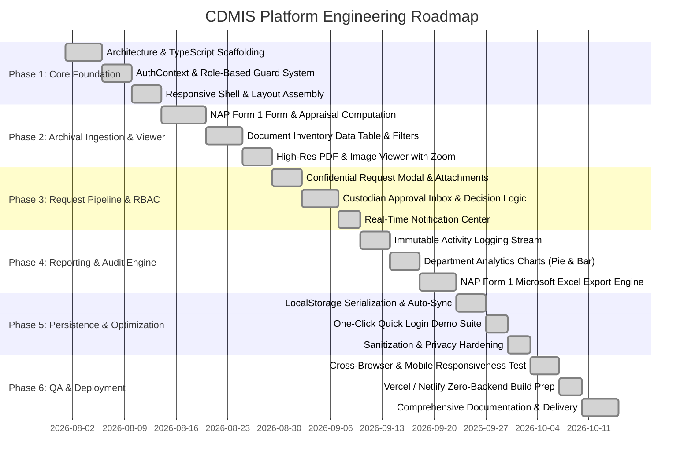
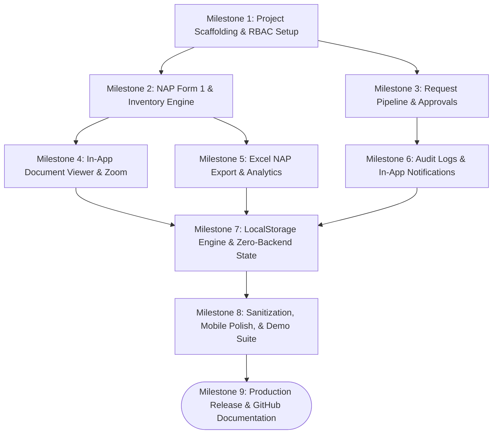
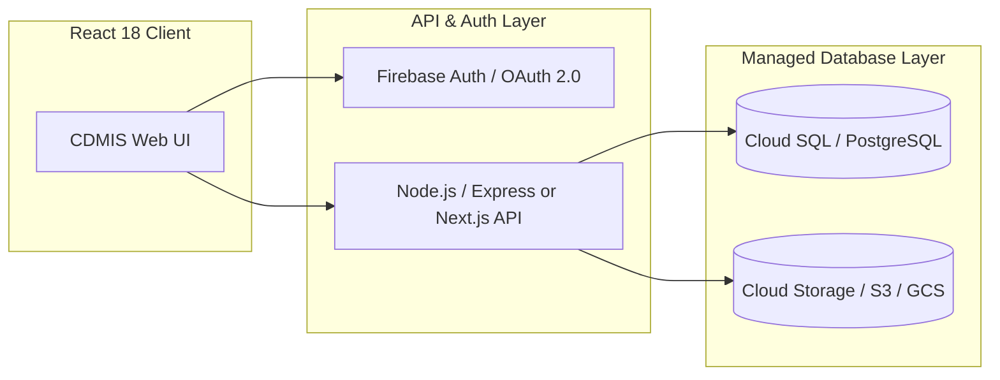

# Implementation Plan & Milestone Roadmap (IMPLEMENTATION_PLAN)
## Centralized Document Management Information System (CDMIS)

---

## 1. Project Implementation Roadmap (Gantt Chart)

The following timeline details the staged development, testing, and deployment cycles for the CDMIS platform:

---

## 2. Milestone Dependency Graph

---

## 3. Work Breakdown Structure (WBS) & Deliverables

### Phase 1: Core Foundation & Security Shell
- **Tasks:**
  1. Define unified TypeScript models (`types.ts`) for Users, Documents, NAP Data, Requests, and Logs.
  2. Implement `AuthContext` with credentials validation and session token persistence.
  3. Create responsive `MainLayout` with collapsible sidebar, active view switching, and role-based link isolation.
- **Verification Criteria:**
  - Authenticated sessions isolate Admin, DRC, and Staff navigation options.
  - Sidebar toggles smoothly without layout jumps on all screen sizes.

### Phase 2: Archival Ingestion & Interactive Viewer
- **Tasks:**
  1. Construct the 4-section `DocumentUploadForm` capturing Office Info, Record Series Details, Appraisal Values, and Digital Attachments.
  2. Implement automatic calculation of Total Retention Years (`Active + Storage`).
  3. Build `DocumentViewerModal` supporting zoomable PDFs (`iframe`) and scalable images (`transform: scale()`) with 50% &ndash; 300% zoom controls.
- **Verification Criteria:**
  - Inputting 2 active years and 3 storage years dynamically renders 5 total years.
  - Zoom in/out buttons scale document smoothly with zero pixelation degradation.

### Phase 3: Access Control & Request Pipeline
- **Tasks:**
  1. Restrict confidential document previews for unauthorized users with an actionable "Request" CTA.
  2. Build `RequestDocumentModal` requiring justification and ID upload.
  3. Develop `RequestList` (Requests Inbox) for Custodians and Admins to issue Approve/Reject decisions with remarks.
  4. Implement real-time notifications for approval/rejection events.
- **Verification Criteria:**
  - Submitting a request updates status to "Pending" and renders a notification for the department custodian.
  - Approving a request instantly unlocks the "View Document" button for the requester.

### Phase 4: Reporting, Audit Engine, & Excel Export
- **Tasks:**
  1. Create chronological append-only audit logging stream in `ActivityLog.tsx`.
  2. Implement custom SVG `PieChart` and `BarChart` components for dashboard statistics.
  3. Engineer client-side NAP Form 1 Excel generator (`handleExportNAPExcel`) outputting official National Archives spreadsheet templates with signatories.
- **Verification Criteria:**
  - Exported `.xls` file opens in Microsoft Excel with intact gridlines, headers, and footer signatory blocks.

### Phase 5: Zero-Backend State Persistence & Portfolio Sanitization
- **Tasks:**
  1. Develop `saveState()` and `loadState()` engine in `mockApi.ts` bound to `localStorage`.
  2. Attach `beforeunload` listeners and 2-second fallback heartbeat sync.
  3. Integrate One-Click Demo Login buttons for all 4 personas on `LoginPage.tsx`.
  4. Replace proprietary university branding with sanitized neutral placeholders.
- **Verification Criteria:**
  - Evaluators can refresh the browser or create new records without losing data.
  - One-click buttons instantly authenticate evaluators in under 1 second.

### Phase 6: Quality Assurance, Mobile Responsiveness, & Deployment
- **Tasks:**
  1. Convert rigid viewport styles to `min-h-screen` and responsive padding (`p-4 sm:p-8`).
  2. Validate complete Vite production build (`npm run build`).
  3. Author project documentation: PRD, TRD, App Flow, Design Brief, Schema, and Implementation Plan.
- **Verification Criteria:**
  - Clean `vite build` with zero TypeScript compiler errors.
  - Flawless mobile rendering on 360px viewports without horizontal clipping.

---

## 4. Risk Management & Mitigation Matrix

| Identified Risk | Severity | Likelihood | Mitigation Strategy |
| :--- | :---: | :---: | :--- |
| **Browser Storage Quota Exceeded** | Low | Low | Only document metadata and simulated URLs are stored in `localStorage`; actual large binary files use ephemeral object URLs. |
| **Accidental State Tampering by Evaluator** | Medium | Low | State self-heals by falling back to original seed data if corrupt JSON is encountered; instructions provided to reset state in Incognito. |
| **Proprietary Data Leakage** | High | Low | Full sanitization audit performed: proprietary logos deleted, generic organization name applied, sample documents anonymized. |
| **Mobile Layout Clipping on Small Screens** | Medium | Low | Replaced fixed `h-screen` containers with fluid `min-h-screen`, responsive typography, and auto-scrolling modal dialogs. |

---

## 5. Production Scaling & Cloud Integration Plan

When transitioning this prototype to an enterprise cloud backend:

1. **Database Layer:** Replace `mockApi.ts` with Cloud SQL (PostgreSQL) using the DDL schema outlined in `BACKGROUND_SCHEMA.md`.
2. **Object Storage:** Direct uploads of PDFs and TIFFs to AWS S3 or Google Cloud Storage via pre-signed URLs.
3. **Authentication:** Connect enterprise Single Sign-On (SSO) via SAML / OAuth 2.0 with institutional Active Directory.
4. **Audit Immutability:** Write activity log stream to an append-only time-series store or write-once cloud audit bucket.
