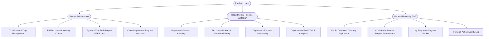
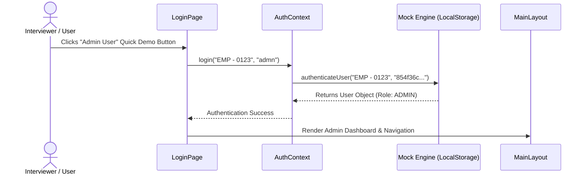
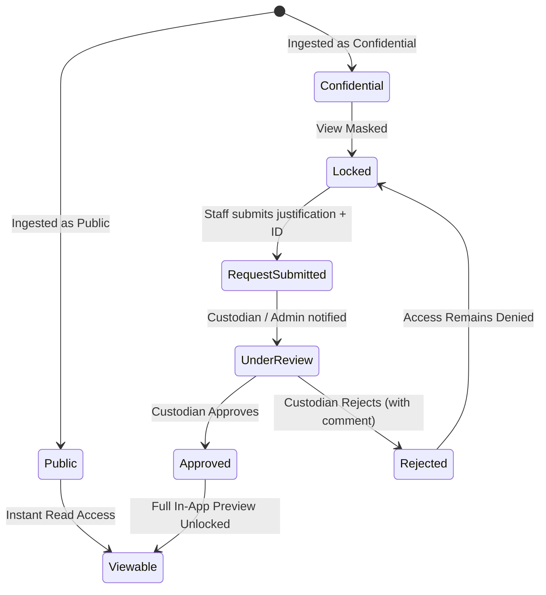

# Product Requirements Document (PRD)
## Centralized Document Management Information System (CDMIS)

---

### Document Information
- **Product Name:** Centralized Document Management Information System (CDMIS) - University Archives Edition
- **Project Type:** Web Application (Zero-Backend Client-Persistent Demo / Enterprise Prototype)
- **Document Version:** 1.0.0
- **Status:** Approved / Production-Ready Demo
- **Target Audience:** University Archives & Records Offices, Administrative Personnel, System Auditors, Technical Evaluators

---

## 1. Executive Summary

The Centralized Document Management Information System (CDMIS) is an institutional-grade records management and archiving portal. Originally designed for higher education institutions and university records and archives offices, the system automates records classification, appraisal, retention scheduling, and access control in compliance with official National Archives standards (specifically modeled on National Archives of the Philippines - NAP Form 1).

This version is an anonymized, high-fidelity portfolio application demonstrating complex enterprise workflows, multi-tiered Role-Based Access Control (RBAC), fine-grained document request/approval cycles, and zero-backend persistent state storage.

```
+-----------------------------------------------------------------------------------+
|                                  CDMIS PLATFORM                                   |
|                                                                                   |
|  [ Auth & RBAC ]  --->  [ NAP Form 1 Ingestion ]  --->  [ Request & Approval ]    |
|  * Admin                * Records Series                 * Confidential Docs      |
|  * DRC (Custodians)     * Appraisal & Values             * Decision Comments      |
|  * Staff Users          * Retention Schedules            * Real-time Alerts       |
|                                                                                   |
|  [ Local DB Engine ]    [ In-App Viewer & Zoom ]        [ Audit & Reporting ]     |
|  * Persistent Storage   * High-Res PDF/Image             * Immutable Log Stream   |
|  * Zero-Backend Setup   * Side-by-Side Metadata          * Excel NAP Form 1 Export|
+-----------------------------------------------------------------------------------+
```

---

## 2. Problem Statement & Business Drivers

### 2.1 The Traditional Challenge
Higher education records departments often struggle with:
- **Fragmented Record Silos:** Documents scattered across decentralized filing cabinets and disparate network folders.
- **Compliance Deficits:** Difficulty generating standardized National Archives appraisal forms (NAP Form 1) with accurate active, storage, and total retention periods.
- **Security Vulnerabilities:** Inadequate differentiation between public circulars and sensitive administrative records.
- **Opaque Auditing:** Lack of immutable audit trails showing who uploaded, reviewed, requested, accessed, or modified critical records.

### 2.2 CDMIS Solution Value
- **Standardized Ingestion:** Guided 4-stage ingestion capturing archival metadata, time value, utility value, and retention periods.
- **Automated Retention Computation:** Automatic validation and calculation of active and storage retention.
- **Hierarchical Access Workflows:** Controlled access with identity verification and justification for confidential documents.
- **Turnkey Portability:** Client-side persistence engine enabling evaluation without infrastructure costs.

---

## 3. User Personas & Role Matrix



### 3.1 Persona Profiles

| Role | Persona Name | Primary Objectives | Key Pain Points Addressed |
| :--- | :--- | :--- | :--- |
| **Administrator** | Records Director | Oversee institutional records policies, manage accounts, monitor compliance, audit all transactions. | Eliminates manual compliance reviews; provides unified activity oversight. |
| **Records Custodian (DRC)** | College/Dept Secretary | Ingest departmental records, specify appraisal parameters, approve requests from other staff. | Solves retention calculation headaches; automates document request handling. |
| **Staff Member** | Faculty / Administrative Staff | Locate institutional policies, forms, and memorandums; request restricted archival files. | Eliminates long paper-based request routing with immediate status tracking. |

---

## 4. Feature Specifications & Requirements

### 4.1 Authentication & RBAC Engine
- **Unique Identifier:** Employee IDs matching standard organizational patterns (`EMP - XXXX`).
- **Simulated Hash Verification:** MD5-equivalent hashing supporting instant verification and password protection.
- **One-Click Demo Suite:** Direct login buttons for Admin, IT Custodian, HR Custodian, and Staff to streamline evaluation.
- **Persistent Session Guard:** Session preservation across page reloads with automatic logout and redirect.



### 4.2 NAP Form 1 Records Inventory & Appraisal
- **Header Metadata:** Name of Office, Department/Division, Telephone No, Section, Official Email, Physical Address, Person-in-Charge, Date Prepared.
- **Record Item Details:** Records Series Title, Description/Remarks, Period Covered, Volume, Medium, Restrictions, Physical/Digital Location, Frequency of Use (Daily, Monthly, ANA, Custom), Duplication details.
- **Appraisal & Valuation:**
  - **Time Value:** Temporary (`T`) or Permanent (`P`).
  - **Utility Value:** Administrative (`Adm`), Fiscal (`F`), Legal (`L`), Archival (`Arc`).
  - **Retention Scheduling:** Active (Years) + Storage (Years) = Automatically calculated Total Retention.
  - **Disposition Provision:** Disposal, Archival, or Special Retention directives.
- **File Attachment:** Support for PDF and TIFF document formats up to 10MB with drag-and-drop.

### 4.3 Document Viewer & Inspection Modal
- **Multi-Format Rendering:** Integrated high-resolution PDF preview via iframe and dynamic image zoom canvas.
- **Interactive Controls:** Zoom in (up to 300%), Zoom out (down to 50%), 1:1 Reset Zoom, and Open in New Tab.
- **Metadata Inspector Drawer:** Side-by-side display of title, description, uploader, upload timestamp, classification, and file attributes.

### 4.4 Access Control & Request Pipeline
- **Public Documents:** Accessible to any authenticated user across the institution.
- **Confidential Documents:** Masked document preview. Users must submit a formal request.
- **Request Submission Form:** Requires purpose/justification and simulated valid ID verification attachment.
- **Custodian Review Hub:** Custodians and Admins inspect pending requests, review justifications, and issue **Approve** or **Reject** decisions accompanied by feedback comments.



### 4.5 Version Control & Document Lifecycle
- **Version Tracking:** Automatic version incrementing (`v1`, `v2`, `v3`).
- **Audit History Modal:** Full visual timeline of previous revisions, timestamps, and upload notes.
- **Lifecycle Statuses:** `Draft` &rarr; `Approved` &rarr; `Archived`.

### 4.6 Reporting & NAP Form 1 Excel Export
- **One-Click NAP Form 1 Generation:** Converts database records into a Microsoft Excel spreadsheet formatted in exact accordance with National Archives specifications.
- **Standardized Headers & Footers:** Formatted signatory blocks for Records Custodian, Head of Office, and Head of Agency.

### 4.7 Audit Logging & Real-Time Notifications
- **Immutable Log Engine:** Tracks logins, uploads, edits, version increments, deletes, access requests, and status changes.
- **Scoped Visibility:** Admins view global university logs; Custodians view department logs; Staff view their personal logs.
- **Notification Center:** Instant alerts informing users when their access request is approved or rejected.

---

## 5. Non-Functional Requirements (NFRs)

| Category | Specification |
| :--- | :--- |
| **Zero-Backend Architecture** | Must run as a 100% static client application with zero cloud database dependency. |
| **Data Persistence** | Must persist all CRUD operations (users, documents, requests, logs) in `localStorage` across page refreshes and browser restarts. |
| **Responsive Design** | Fluid layout adapting from mobile screens (360px) to ultra-wide displays (4K). |
| **Privacy & Sanitization** | Strict removal of proprietary university logos, personnel identifiers, and confidential files. |
| **Performance** | Sub-100ms UI transitions, client-side debounced search (300ms), sub-1s cold start. |
| **Accessibility & UX** | High-contrast WCAG 2.1 AA compliant badges, intuitive iconography, responsive touch targets. |

---

## 6. Success Metrics & KPIs
1. **Zero Setup Friction:** Evaluators can inspect the entire system in under 15 seconds using quick-login buttons.
2. **Workflow Completeness:** 100% pass rate on end-to-end user journeys (Upload &rarr; Request &rarr; Approve &rarr; View &rarr; Audit &rarr; Export).
3. **Data Integrity:** Zero data loss across session reloads during user testing.
