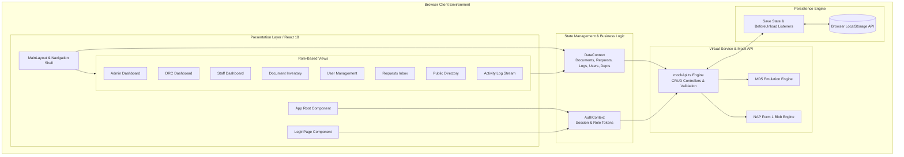
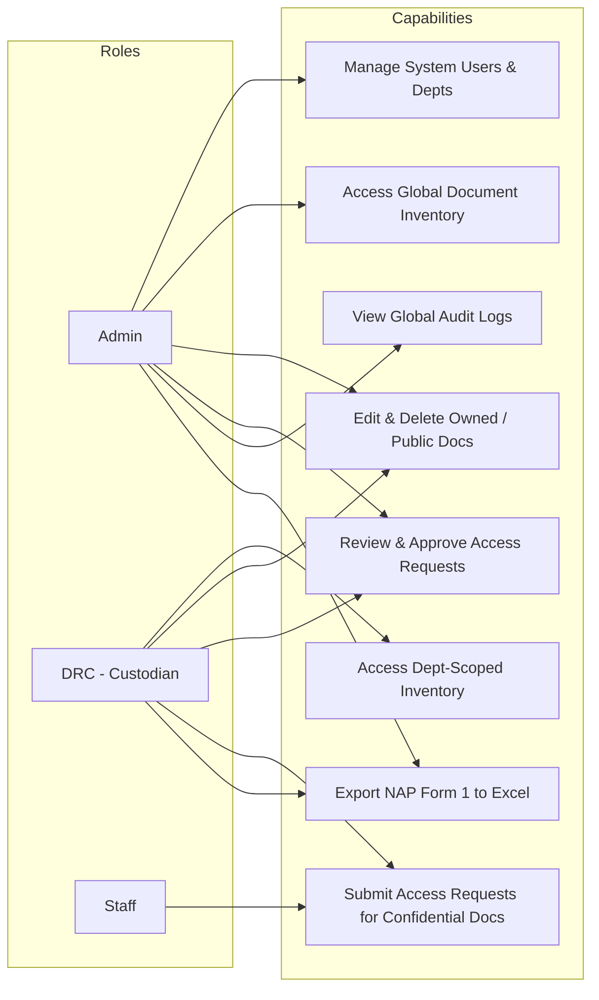

# Technical Requirements Document (TRD)
## Centralized Document Management Information System (CDMIS)

---

### Technical Specification Overview
- **System Type:** Single Page Application (SPA)
- **Primary Framework:** React 18.x with TypeScript 5.x
- **Build & Dev Tool:** Vite 6.x
- **CSS Architecture:** Tailwind CSS (utility-first, modern fluid container system)
- **State & Storage Architecture:** Context API + Custom `localStorage` Serialization Engine
- **Target Hosting:** Static Web Hosting (Vercel, Netlify, Cloudflare Pages, GitHub Pages)

---

## 1. System Architecture Diagram



---

## 2. Technology Stack & Dependencies

| Layer | Technology | Version | Purpose / Rationale |
| :--- | :--- | :--- | :--- |
| **Runtime** | React | 18.2.0 | Declarative component model, virtual DOM diffing, reactive hooks. |
| **Language** | TypeScript | 5.0.x | Strict type safety across document metadata, NAP records, and access roles. |
| **Bundler** | Vite | 6.x | Fast Hot Module Replacement (HMR) and optimized Rollup production builds. |
| **Styling** | Tailwind CSS | 3.4.x / CDN | Utility-first styling with zero runtime CSS bundle overhead and fluid responsiveness. |
| **Storage Engine** | Browser `localStorage` | Web API | Zero-cost persistent storage with synchronous read and debounced atomic write. |
| **File Generation** | Browser Blob API | Web API | Generates real Microsoft Excel XML tables directly in memory without server workers. |

---

## 3. Data Flow & State Management Architecture

```mermaid
sequenceDiagram
    autonumber
    participant UI as Component (e.g., DocumentUploadForm)
    participant Ctx as DataContext (useData Hook)
    participant API as mockApi Service
    participant Storage as LocalStorage Engine
    participant Log as Activity Logger

    UI->>Ctx: addDocument(docData)
    Ctx->>API: addDocumentAPI(docData)
    API->>API: Validate fields & Assign UUID
    API->>Log: logActivity("EMP-XXXX", "DOCUMENT_UPLOAD", details)
    API->>Storage: saveState() -> Serialize state into JSON keys
    Storage-->>API: Write committed
    API-->>Ctx: Return new Document Object
    Ctx->>UI: State updated; triggers re-render across subscribers
```

### 3.1 Context Architecture
- **`AuthContext` (`context/AuthContext.tsx`):**
  - Manages `currentUser: User | null` and `isAuthenticated: boolean`.
  - Persists active login state in `sessionStorage` (`CDMIS_USER`).
  - Exposes `login(userId, password)` and `logout()`.
- **`DataContext` (`context/DataContext.tsx`):**
  - Consolidates state for: `documents`, `requests`, `logs`, `users`, `departments`, `notifications`.
  - Exposes reactive mutators: `addDocument`, `editDocument`, `deleteDocument`, `createRequest`, `processRequest`, `addUser`, `editUser`, `deleteUser`, `addDepartment`, `editDepartment`, `deleteDepartment`, `markNotificationRead`.

### 3.2 Persistent Local Storage Engine
To eliminate cloud database costs while ensuring evaluator data persists indefinitely:
- **Keys Tracked:**
  - `cdmis_users`: User directory and role definitions.
  - `cdmis_departments`: Department catalog.
  - `cdmis_documents`: Comprehensive document database and NAP Form 1 records.
  - `cdmis_requests`: Document access requests and review statuses.
  - `cdmis_logs`: Immutable chronological audit logs.
  - `cdmis_notifications`: User-specific in-app notifications.
- **Sync Strategy:**
  - **Cold Start (`loadState`):** Reads from `localStorage`; if empty, defaults to seeded initial database.
  - **Mutation Commits (`saveState`):** Invoked synchronously on every state-mutating action.
  - **Safety Net:** `beforeunload` event hook and periodic 2000ms heartbeat interval safeguard against unhandled tab closures.

---

## 4. Role-Based Access Control (RBAC) Technical Matrix



### 4.1 Granular Permissions Table

| Action / Resource | Admin | DRC (Custodian) | Staff Member | Implementation Mechanism |
| :--- | :---: | :---: | :---: | :--- |
| **View Public Documents** | ✅ | ✅ | ✅ | Filter predicate: `restrictionType === 'Public'` |
| **View Confidential Documents** | ✅ | Department-Scoped | Requires Approved Request | Evaluated via `requests.some(r => r.status === 'Approved')` |
| **Upload Document & NAP Form 1** | ✅ | ✅ (Own Dept) | ❌ | UI Action Button conditionally rendered by role |
| **Edit Document Metadata** | ✅ | ✅ (Own Dept) | ❌ | Restricted to uploader ID or Admin |
| **Rollback / Inspect Versions** | ✅ | ✅ (Own Dept) | ❌ | Modal triggered only if `hasEditAccess` |
| **Approve / Reject Requests** | ✅ (Global) | ✅ (Dept-Scoped) | ❌ | Filtered by `request.document.department === currentUser.department` |
| **Manage Users & Departments** | ✅ | ❌ | ❌ | Route and sidebar item isolated to `Role.ADMIN` |
| **Inspect System Audit Logs** | Global | Dept-Filtered | Personal-Only | Filtered dynamically on `log.department` or `log.userId` |
| **Export NAP Form 1 Excel** | ✅ | ✅ | ❌ | Triggered via `handleExportNAPExcel` |

---

## 5. Document Rendering & Export Pipelines

### 5.1 Interactive In-App Document Viewer Pipeline
The `DocumentViewerModal` handles heterogeneous file formats without third-party plugins:
1. **File Extension Inspection:** Resolves whether `fileName` / `fileUrl` represents a PDF, image, or raw file.
2. **PDF Engine:** Renders via an isolated, styled HTML `iframe` pointing to the resource URL or Blob URI.
3. **Image Engine:** Renders via an HTML `` tag with matrix scale transform (`scale(${zoom})`).
4. **Zoom Controller:** Provides discrete 25% zoom increments clamped between 50% and 300% with CSS hardware acceleration (`transform-origin: top center`).
5. **Metadata Inspector:** Synchronous 320px flex sidebar displaying indexed metadata, uploader, timestamp, and classifications.

### 5.2 NAP Form 1 Excel Export Pipeline
The export pipeline dynamically compiles Microsoft Excel-compatible HTML/XML tables:
```javascript
const blob = new Blob([tableTemplate], { type: 'application/vnd.ms-excel' });
const url = window.URL.createObjectURL(blob);
```
- Includes official National Archives XML headers (`xmlns:o`, `xmlns:x`).
- Builds merged row headers (`colspan`, `rowspan`) representing:
  - Header: Office Name, Division, Telephone, Address, Person-in-Charge, Date Prepared.
  - Table: Records Series Title, Period, Volume, Medium, Restriction, Location, Frequency, Duplication, Time Value, Utility Value, Active/Storage/Total Retention, Disposition.
  - Signatory Footer: Records Custodian, Head of Office, Head of Agency.

---

## 6. Performance & Responsive Constraints

- **Responsive Viewport Spectrum:**
  - Mobile Small: 360px &ndash; 639px
  - Tablet: 640px &ndash; 1023px
  - Desktop Standard: 1024px &ndash; 1439px
  - Large / Ultrawide: 1440px+
- **Layout Architecture:**
  - Viewport root container configured with `min-h-screen flex` to prevent clipping.
  - Collapsible drawer sidebar (`w-64` to `w-0`) with hardware-accelerated transitions.
  - Debounced search queries (`300ms`) to minimize re-computations of large filtered datasets.
