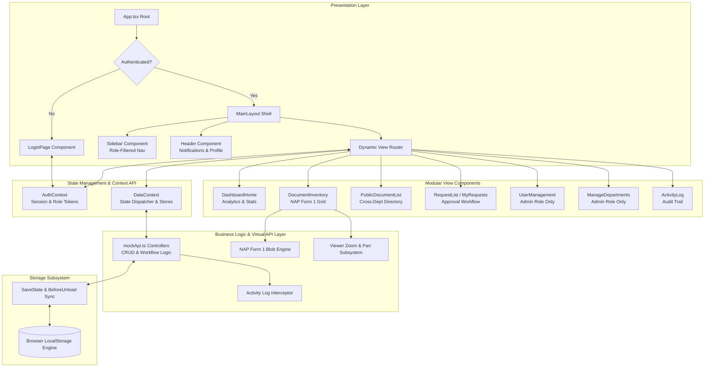
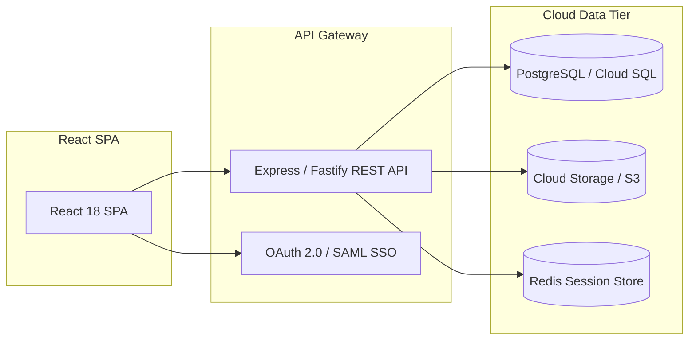

# Project Architecture (ARCHITECTURE.md)
## Centralized Document Management Information System (CDMIS)

---

## 1. Architectural Overview & Design Pattern

CDMIS is structured around a **Decoupled, Layered Single Page Application (SPA)** architecture built on React 18, TypeScript, and Vite. Designed to function with zero external infrastructure costs, the application employs a **Client-Side Virtual Database Engine** with automatic browser storage serialization, simulating the behavior and latency characteristics of a real enterprise backend.

```
+---------------------------------------------------------------------------------------+
|                                    CLIENT BROWSER                                     |
+---------------------------------------------------------------------------------------+
|  [ LAYER 1: PRESENTATION & UI ]                                                       |
|  * React 18 Functional Components & Hooks (Split Layouts, Modals, Drawers)            |
|  * Tailwind CSS Utility Design System (Responsive, Fluid Breakpoints)                 |
|  * Native Canvas & SVG Visualizations (Pie & Bar Analytics Charts)                    |
+---------------------------------------------------------------------------------------+
                                           |
                                           v
+---------------------------------------------------------------------------------------+
|  [ LAYER 2: STATE & CONTEXT PROVIDERS ]                                               |
|  * AuthContext: Session Tokens, Role Guards, User Persona State                       |
|  * DataContext: Global Reactive Document Store, Request Pipeline, Logs, Notifications |
+---------------------------------------------------------------------------------------+
                                           |
                                           v
+---------------------------------------------------------------------------------------+
|  [ LAYER 3: SERVICE & BUSINESS LOGIC ENGINE ]                                         |
|  * mockApi Controllers: User CRUD, Dept Catalog, NAP Form 1 Metadata Validation       |
|  * Access Control Enforcement: Role Checks (ADMIN, DRC, STAFF), Document Masking       |
|  * Document & Export Pipelines: In-Memory Blob Generator, XML Spreadsheet Engine      |
|  * Audit Log Interceptor: Automatic event tracking for all system mutations          |
+---------------------------------------------------------------------------------------+
                                           |
                                           v
+---------------------------------------------------------------------------------------+
|  [ LAYER 4: PERSISTENCE & STORAGE SUBSYSTEM ]                                         |
|  * Browser LocalStorage API with JSON Schema Serialization                            |
|  * Event Hooks: beforeunload sync, 2000ms heartbeat guard                             |
|  * Self-Healing State: Automated fallback to seed dataset if corrupt data encountered |
+---------------------------------------------------------------------------------------+
```

---

## 2. Multi-Tier Architecture Diagram



---

## 3. Directory & Codebase Organization

The codebase follows a domain-driven, modular directory hierarchy:

```
├── docs/                       # Project Documentation Suite
│   ├── ARCHITECTURE.md         # Multi-tier system architecture & subsystems
│   ├── PRD.md                  # Product Requirements Document
│   ├── TECHNICAL_REQUIREMENTS.md# Technical specifications & RBAC matrix
│   ├── APP_FLOW.md             # Navigation maps & sequence flows
│   ├── DESIGN_BRIEF.md         # UI/UX design guidelines & wireframes
│   ├── BACKGROUND_SCHEMA.md    # Relational models & ERD specifications
│   └── IMPLEMENTATION_PLAN.md  # Engineering roadmap & milestones
│
├── database/                   # Database Schemas & Seeds
│   └── schema.sql              # Relational DDL & seed script
│
├── components/                 # Component Library
│   ├── auth/
│   │   └── LoginPage.tsx       # Split-screen responsive authentication portal
│   ├── dashboard/
│   │   ├── AdminDashboard.tsx  # View router for Administrator persona
│   │   ├── DrcDashboard.tsx    # View router for Records Custodian persona
│   │   ├── StaffDashboard.tsx  # View router for Staff persona
│   │   └── DashboardHome.tsx   # Visual charts, metrics cards, and recent widgets
│   ├── layout/
│   │   ├── Header.tsx          # App header with notification badge and user menu
│   │   ├── MainLayout.tsx      # Main application layout and sidebar controller
│   │   └── Sidebar.tsx         # Collapsible sidebar with role-filtered links
│   └── shared/
│       ├── ActivityLog.tsx     # Filterable system audit trail
│       ├── BarChart.tsx        # Responsive SVG bar visualization
│       ├── DocumentInventory.tsx# Dual-table document records and viewer modal
│       ├── DocumentUploadForm.tsx# 4-section NAP Form 1 appraisal ingestion modal
│       ├── ManageDepartments.tsx# Department catalog CRUD
│       ├── MyRequests.tsx      # Personal access request tracking table
│       ├── NotificationsView.tsx# Notification center view
│       ├── PieChart.tsx        # Responsive SVG distribution chart
│       ├── ProfilePage.tsx     # Current user profile and credentials viewer
│       ├── PublicDocumentList.tsx# Public cross-department records directory
│       ├── RequestDocumentModal.tsx# Modal for requesting confidential documents
│       ├── RequestList.tsx     # Custodian inbox for processing pending requests
│       └── UserManagement.tsx  # User account provisioning and role assignments
│
├── context/
│   ├── AuthContext.tsx         # Authentication state, login/logout, session tokens
│   └── DataContext.tsx         # Shared state for docs, users, requests, and logs
│
├── services/
│   ├── mockApi.ts              # Virtual backend, LocalStorage sync, and seed data
│   └── mysqlApi.ts             # Backend integration service
│
├── types.ts                    # Universal TypeScript data contracts and enums
├── App.tsx                     # Top-level authentication conditional renderer
├── index.html                  # HTML5 entry point with responsive viewport
├── index.tsx                   # React root hydration and context wrapping
├── package.json                # Project dependencies and Vite build scripts
├── tsconfig.json               # TypeScript compiler rules and path mappings
├── vite.config.ts              # Vite bundler configuration
├── README.md                   # Repository overview & setup instructions
└── LICENSE                     # Open-source MIT License
```

---

## 4. Key Subsystems & Design Decisions

### 4.1 Zero-Backend Persistence Engine
- **Rationale:** Eliminate cloud infrastructure dependencies and cost for portfolio deployment while preserving live database behavior.
- **Implementation:** Data is stored in memory (`let mockDocuments`, `let mockUsers`, etc.) for synchronous, zero-latency access by UI components. A persistence worker (`saveState`) writes dirty states to browser `localStorage`.
- **Durability:** The app registers a `beforeunload` window event listener and a recurring 2000ms sync heartbeat, ensuring no in-flight changes are lost upon reload or browser exit.

### 4.2 Security & Authorization Guard Pattern
- **Role Scoping:** Evaluated at both layout and component levels:
  - **Administrator:** Unrestricted read/write access to all departments, global users, and cross-department audit logs.
  - **Department Records Custodian (DRC):** Write and review access strictly scoped to documents within their assigned department (`currentUser.department === doc.department`).
  - **Staff:** Read-only access to public records; access to confidential records is gated behind an approval workflow with verified digital tokens.

### 4.3 Ingestion & Compliance Engine (NAP Form 1)
- **Standardized Archival Compliance:** Implements National Archives Form 1 (Records Inventory and Appraisal) data models.
- **Automated Retention Logic:** The system dynamically evaluates:
  $$\text{Total Retention (Years)} = \text{Active Retention} + \text{Storage Retention}$$
- **Native Document Export:** Generates official `.xls` XML spreadsheets directly within the client browser utilizing the native `Blob` and `URL.createObjectURL` APIs, with built-in printable signatory blocks for audit compliance.

---

## 5. Production Cloud Evolution Pathway

When scaling the architecture to an enterprise production environment:



1. **Storage Subsystem:** Transition from `localStorage` to Cloud SQL (PostgreSQL) using the DDL schema in `BACKGROUND_SCHEMA.md`.
2. **File Processing:** Replace client Blob URLs with Amazon S3 / Google Cloud Storage buckets using short-lived pre-signed download and upload URLs.
3. **Session Management:** Upgrade simulated MD5 hashes to bcrypt/Argon2id and replace `sessionStorage` tokens with secure, HTTP-only JWTs.
